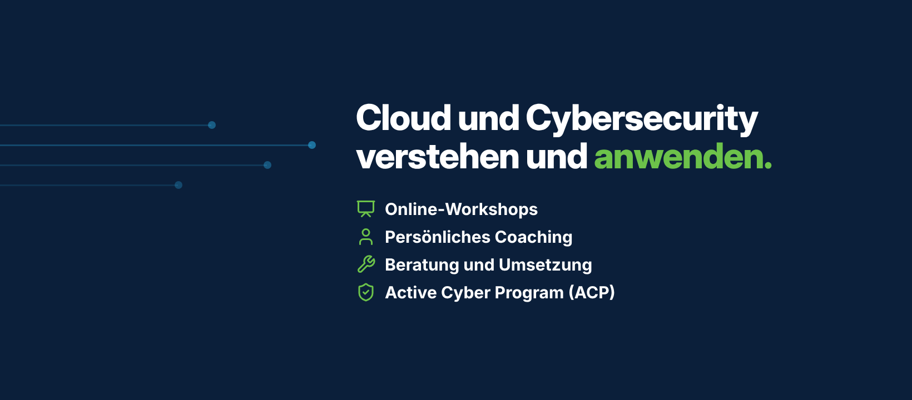

# Tom Wechsler
**Cloud Solution Architect · Cybersecurity Architect · Trainer**

Seit 2000 in der IT und seit 2007 selbständig. Ich unterstütze Organisationen in Deutschland, der Schweiz und Österreich dabei, sichere IT-Umgebungen zu planen und zu betreiben.

## Active Cyber Program

Ich habe das [Active Cyber Program (ACP)](https://github.com/tomwechsler/active-cyber-program) entwickelt und pflege es. ACP hilft Organisationen, einen verständlichen Einstieg in Cybersecurity zu finden – mit klaren Fragen, einem nachvollziehbaren Resultat und konkreten nächsten Schritten.

Ich führe die offiziellen ACP-Assessments derzeit selbst durch. Für die Unabhängigkeit gilt: Organisationen, die ich in den letzten 24 Monaten zu ihrem Cybersecurity-Programm beraten habe, kann ich nicht assessieren. Mehr dazu in den [Governance-Regeln](https://github.com/tomwechsler/active-cyber-program/blob/main/docs/governance.md#impartiality).

## Schwerpunkte

- Cybersecurity-Architektur und Cybersecurity-Programme
- Microsoft Azure und hybride Infrastrukturen
- Netzwerksicherheit und Sicherheit von KI-Systemen
- Schulungen für IT-Teams, Mitarbeitende und Geschäftsleitungen

## Angebote

Online-Workshops · Persönliches Coaching · Beratung und Umsetzung

## Ausgewählte Zertifizierungen

- ISC2 CISSP und CCSP
- Microsoft Certified: Cybersecurity Architect Expert
- Microsoft Certified: Azure Solutions Architect Expert
- Certified NIST CSF 2.0 Lead Implementer und Lead Auditor

## Kontakt

[LinkedIn](https://www.linkedin.com/in/tom-wechsler) ·
[Active Cyber Program](https://acp.videotrainer.ch/) ·
[training@videotrainer.ch](mailto:training@videotrainer.ch)
